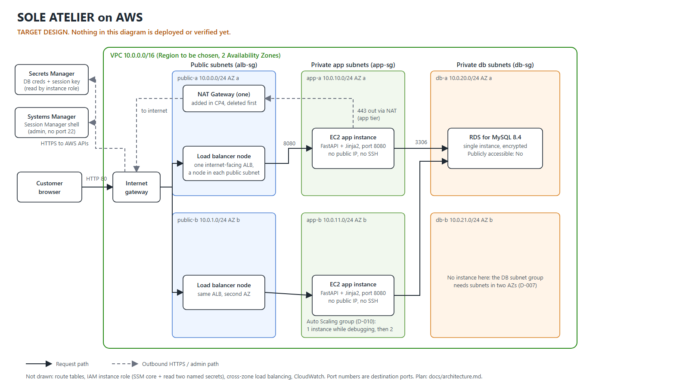

# Architecture overview

**Status of everything on AWS in this file: PLANNED.** No AWS resource has been created or verified. What *is* implemented and tested is the application itself, running locally on SQLite (see [testing.md](testing.md)).

Editable source: [diagrams/architecture.svg](diagrams/architecture.svg). The diagram shows the design only; it will be replaced or annotated with real screenshots as checkpoints are verified (see [../screenshots/README.md](../screenshots/README.md)).

## What the system does

SOLE ATELIER is a fictional sneaker boutique used as a realistic workload for the AWS design: server-rendered storefront pages, a JSON catalogue and cart API, and a demonstration checkout that records orders in a relational database. No payment is taken.

## Request flow (design)

1. The customer's browser sends HTTP on port 80 to the internet-facing Application Load Balancer. The ALB has a node in each public subnet and `alb-sg` allows 80 from the internet.
2. The ALB forwards to the FastAPI instances on port 8080. `app-sg` accepts 8080 only from `alb-sg`. The instances sit in private subnets with no public IP.
3. The application reads and writes MySQL on port 3306. `db-sg` accepts 3306 only from `app-sg`. The RDS instance is not publicly accessible and its subnets have no route to the internet.
4. At startup the instance reads two secrets (application DB credentials, session-signing key) from Secrets Manager using its IAM role. The call leaves the VPC through the NAT gateway because no VPC endpoints are used (see D-006).
5. An administrator opens a shell through Session Manager. No port 22 is open and there is no key pair.

The load balancer health check calls `GET /health` (liveness, no database access). `GET /health/ready` also checks the database and is for humans and diagnostics. Reason: if the ALB checked the database, a short database outage would mark every instance unhealthy and turn a partial failure into a full outage (D-013).

## Network plan

| Subnet | AZ | CIDR | Route to internet |
|---|---|---|---|
| public-a | a | 10.0.0.0/24 | IGW |
| public-b | b | 10.0.1.0/24 | IGW |
| app-a | a | 10.0.10.0/24 | NAT (added in CP4) |
| app-b | b | 10.0.11.0/24 | NAT in AZ a (added in CP4) |
| db-a | a | 10.0.20.0/24 | none (local only) |
| db-b | b | 10.0.21.0/24 | none (local only) |

An RDS DB subnet group must span at least two Availability Zones even for a single-instance database ([AWS docs](https://docs.aws.amazon.com/AmazonRDS/latest/UserGuide/USER_VPC.WorkingWithRDSInstanceinaVPC.html), checked 2026-10-15), which is why db-b exists although no instance runs there.

## Security group chain

| Group | Inbound | Outbound |
|---|---|---|
| alb-sg | TCP 80 from 0.0.0.0/0 | TCP 8080 to app-sg |
| app-sg | TCP 8080 from alb-sg | TCP 3306 to db-sg; TCP 443 to 0.0.0.0/0 |
| db-sg | TCP 3306 from app-sg | none |

Rules reference security groups, not CIDR ranges, so access follows the tier rather than IP addresses that change when instances are replaced.

## AWS services and why each is used

| Service | Role | Why this and not something else |
|---|---|---|
| VPC, subnets, route tables, IGW | Network isolation | The subject of the project: public/private separation is a routing decision, not a name |
| Security groups | Tier-to-tier access control | Stateful and referenceable by group; simpler and less error-prone than NACLs for this size |
| EC2 (via launch template and Auto Scaling group) | Runs FastAPI | Teaches the instance, IAM role and bootstrap pieces directly; two instances in two AZs show replacement behaviour |
| Application Load Balancer | Public entry point and health checks | Layer 7, health checks, spans AZs; keeps instances private |
| RDS for MySQL | Relational store | Managed backups, patching and encryption; the order model is relational (D-007) |
| NAT gateway | Outbound HTTPS for private instances | Package installs and AWS API calls; a metered, single-AZ trade-off (D-006) |
| Secrets Manager | DB credentials and session key | Keeps secrets out of code and user data (D-008) |
| IAM role (instance profile) | Least-privilege access | Read two named secrets and use Session Manager |
| Systems Manager Session Manager | Admin shell | No inbound port, no key pair (D-005) |

Not used (deliberately): Route 53, ACM/HTTPS, WAF, CloudFront, Multi-AZ RDS, containers, Terraform, CI/CD. Each is a production improvement discussed in [security.md](security.md) and [project-summary.md](project-summary.md), not an oversight.

## Application design (implemented, tested locally)

- **Stack:** Python, FastAPI, Jinja2 templates, vanilla JavaScript, SQLAlchemy 2. Backend code is in [../backend/](../backend/README.md); the server-rendered frontend (templates, CSS, JavaScript, images, fonts) is in [../frontend/](../frontend/README.md). FastAPI renders the templates and serves the static files itself, so there is one process to deploy.
- **Cart:** held in a signed session cookie as product id, size and quantity only. Prices, names and stock are re-read from the database on every request, so a tampered cookie cannot change what is charged. Because the cookie is signed with a shared key, either instance can serve any request without sticky sessions.
- **Orders:** created in one transaction. Stock is reserved with a conditional `UPDATE ... WHERE stock >= quantity`, so two buyers cannot take the last pair. Order lines snapshot name and price. An idempotency key makes a double submit return the original order.
- **Schema:** `products`, `product_sizes` (stock per size), `orders`, `order_items`. Money is `NUMERIC(10,2)`.
- **Database selection:** `DATABASE_URL` (SQLite locally) or `DB_HOST` plus credentials from Secrets Manager (MySQL on RDS), by environment variables only.

Details and limits: [security.md](security.md), [testing.md](testing.md).

## Failure behaviour (design, not yet observed)

| Failure | Expected effect | Why |
|---|---|---|
| One app instance dies | Service continues; ASG replaces it | Two instances in two AZs, ELB health checks |
| AZ a fails | Likely outage | NAT gateway and RDS instance are in AZ a (D-006, D-007) |
| Database unreachable | Catalogue and checkout return 503; `/health` stays 200 | Handled error path tested locally; AWS behaviour unobserved |
| Secrets Manager unreachable at startup | Instance fails to start the app | Fail fast rather than run with no credentials |
