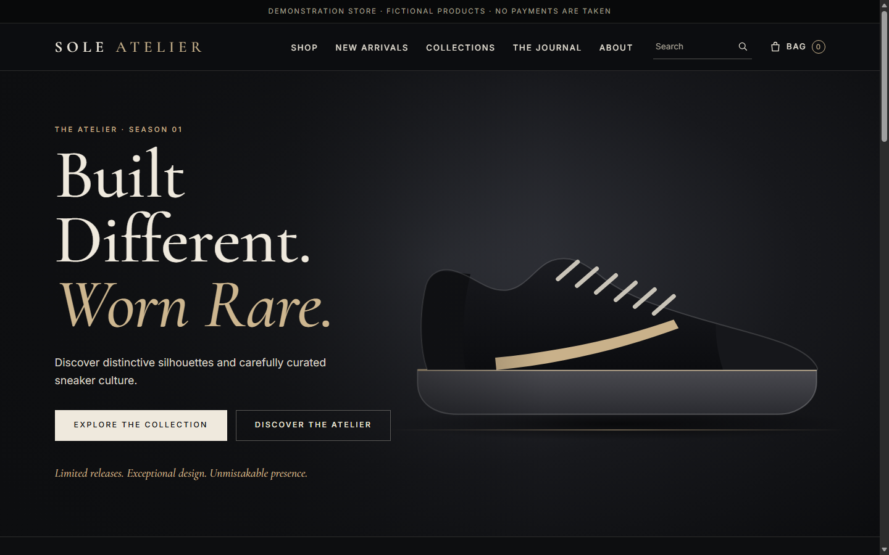
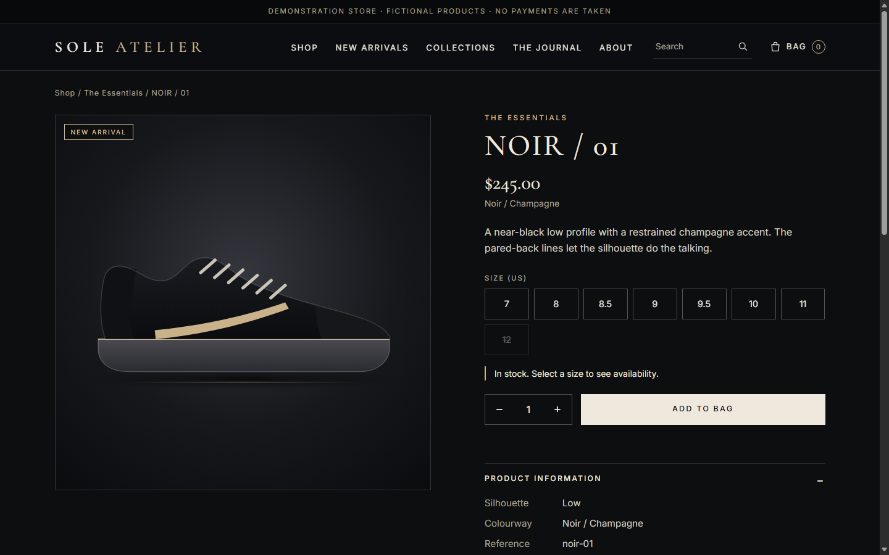
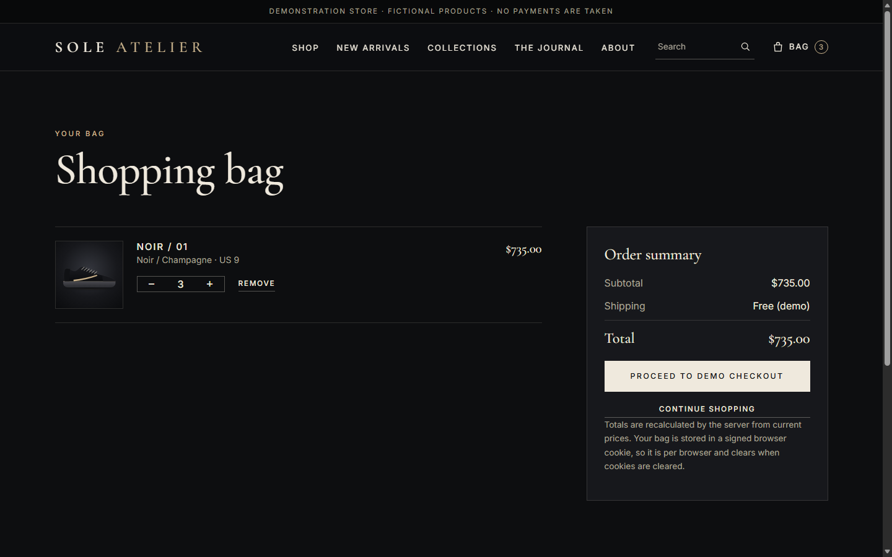
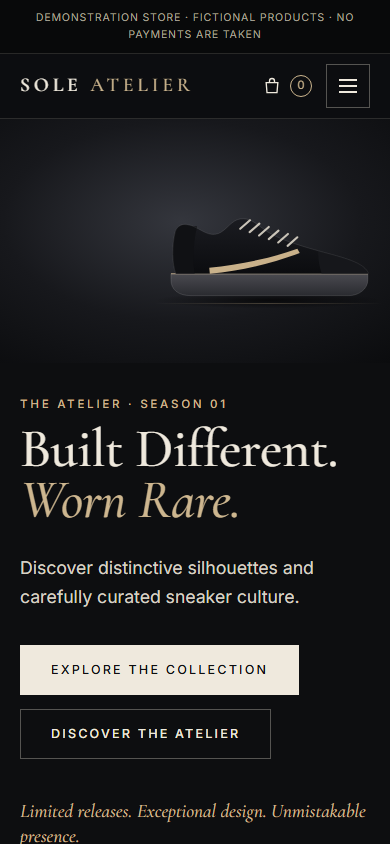

# Screenshots

This folder is the project's evidence gallery. **Only real screenshots belong here.** No mock-ups, stock images or AI-generated console pages, ever. If an item below is `PENDING`, the resource or test it shows does not exist yet and no claim should be made about it.

Two kinds of images live here and they mean different things:

| Kind | Where | Meaning |
|---|---|---|
| **Local application** | `06-application/` (files without the `aws-` prefix) | Captured by Claude's browser test (`tools/browser-smoke.mjs`, real Edge, local SQLite, fictional demo data). Proves the app renders and behaves locally. **Not AWS.** |
| **AWS Console and AWS tests** | `01` to `05`, `06-application/aws-*`, `07-validation` | Captured by **you** from the AWS Management Console and from tests against your own deployment. All `PENDING` today |

The architecture diagram is a **design**, not evidence: it lives at the repository root as [../architecture.png](../architecture.png) (source: [../docs/diagrams/architecture.svg](../docs/diagrams/architecture.svg)). It is not duplicated here.

The authoritative list of what each image proves is [../docs/project/EVIDENCE_REGISTER.md](../docs/project/EVIDENCE_REGISTER.md). This file is the capture checklist; the register is the inventory. There is no second register.

## Before any image leaves `evidence/raw/`: hide these

- [ ] 12-digit **AWS account ID** (top-right account menu, ARNs, URLs)
- [ ] **Public IP addresses**, Elastic IPs, and the **ALB DNS name** if you do not want it public
- [ ] **RDS endpoint** hostname and the **secret ARNs**
- [ ] **Email addresses** (budget alerts, IAM, account name)
- [ ] **Credentials of any kind**: access keys, passwords, session tokens. If one appears, stop, tell Claude, and rotate it
- [ ] **Database contents** about people: mask names, emails and addresses in order rows
- [ ] Browser tabs, bookmarks and other windows

Workflow: capture to `evidence/raw/` (never published) > redact a copy > save the redacted copy in the folder below with the numbered name > record it in the register and change the `PENDING` here to `CAPTURED`. `node tools/check-docs.mjs` fails if a row says `CAPTURED` and the file is missing.

## What a good capture contains

1. The **Region selector** visible.
2. The **resource name** and the **specific tab** that shows the setting (a route table needs two shots: Routes and Subnet associations).
3. For a test, the **command or action and its result** together, with the time.
4. One idea per image. Name the file `NN-short-description.png` as listed below.

Remember what an image proves: a configuration screenshot shows how something is set, **not** that it behaves that way. Behaviour needs a test result.

## How to add a screenshot (step by step)

1. Do the checkpoint in the AWS Console and take the screenshot (Windows: `Win+Shift+S`).
2. Save the original in `evidence/raw/` (git-ignored, never published).
3. Copy it, blur the items in the checklist above, and save the copy in the right folder with the exact numbered name from the tables below.
4. In this file change that row from `PENDING` to `CAPTURED`.
5. In the register, put the path in "Evidence files" for that E-row and update the status honestly (`IMPLEMENTED` for a configuration shot, `VERIFIED` only for an observed behaviour).
6. Run `node tools/check-docs.mjs`. Send the image to Claude for review before moving on.

## Checklist

Status values: `PENDING` (nothing captured), `CAPTURED` (file exists, reviewed). Evidence IDs are rows in the register.

### 01-architecture

| File | Must show | Evidence | Status |
|---|---|---|---|
| `01-vpc-resource-map.png` | VPC > **Resource map** for `mt-vpc`: subnets, route tables, IGW, NAT, as built (compare with `architecture.png`) | E-003 | PENDING |

### 02-networking

| File | Must show | Evidence | Status |
|---|---|---|---|
| `01-vpc-details.png` | `mt-vpc` 10.0.0.0/16 with **DNS hostnames enabled** | E-003 | PENDING |
| `02-subnets-list.png` | Six subnets: name, AZ, CIDR columns, two AZs | E-003 | PENDING |
| `03-public-rt-routes.png` | `mt-public-rt` **Routes** tab with `0.0.0.0/0` to an `igw-` | E-004 | PENDING |
| `04-public-rt-associations.png` | `mt-public-rt` **Subnet associations**: only the two public subnets | E-004 | PENDING |
| `05-app-rt.png` | `mt-app-rt` routes (local only before NAT; add a second capture after CP4 with the NAT route) and associations | E-004 | PENDING |
| `06-db-rt.png` | `mt-db-rt` routes: **local only**, plus associations | E-004 | PENDING |
| `07-nat-gateway.png` | NAT gateway state Available, subnet `mt-public-a`, Elastic IP (blurred) | E-004 | PENDING |

### 03-compute

| File | Must show | Evidence | Status |
|---|---|---|---|
| `01-launch-template.png` | `mt-app-lt` details: AMI, type, SG `mt-app-sg`, **no key pair**, IMDSv2 required, instance profile | E-011 | PENDING |
| `02-user-data-redacted.png` | User data with placeholders, **no secret values** | E-013 | PENDING |
| `03-asg-details.png` | `mt-app-asg`: two subnets in two AZs, launch template, capacity | E-009 | PENDING |
| `04-instance-no-public-ip.png` | Instance details: **no public IPv4**, role attached, private subnet | E-010 | PENDING |
| `05-target-group-healthy.png` | `mt-app-tg` **Targets**: two healthy targets in different AZs | E-009 | PENDING |
| `06-alb-details.png` | `mt-alb`: internet-facing, the two public subnets, `mt-alb-sg`, listener 80 | E-009 | PENDING |

### 04-security

| File | Must show | Evidence | Status |
|---|---|---|---|
| `01-alb-sg-rules.png` | Inbound and outbound rules of `mt-alb-sg` | E-005 | PENDING |
| `02-app-sg-rules.png` | `mt-app-sg`: 8080 from `mt-alb-sg`, **no port 22**, outbound 3306 to db-sg and 443 | E-005, E-011 | PENDING |
| `03-db-sg-rules.png` | `mt-db-sg`: 3306 from `mt-app-sg` only, no outbound | E-005 | PENDING |
| `04-iam-role-permissions.png` | `mt-app-role`: SSM core policy plus the inline policy limited to two secrets | E-011 | PENDING |
| `05-root-mfa.png` | Security credentials: MFA assigned (account ID blurred) | E-002 | PENDING |
| `06-nonroot-session.png` | Console header showing a non-root principal | E-002 | PENDING |
| `07-budget.png` | Budget with thresholds (email blurred) | E-001 | PENDING |

### 05-database

| File | Must show | Evidence | Status |
|---|---|---|---|
| `01-db-subnet-group.png` | `mt-db-subnets` with the two db subnets in two AZs | E-006 | PENDING |
| `02-rds-connectivity.png` | **Connectivity & security**: Publicly accessible **No**, VPC, subnet group, `mt-db-sg` (endpoint blurred) | E-006 | PENDING |
| `03-rds-encryption.png` | Configuration: encryption enabled, engine version, instance class, storage | E-006 | PENDING |
| `04-secrets-list.png` | Secrets list showing **names only** (no values) | E-013 | PENDING |
| `05-parameter-group.png` | `require_secure_transport` = 1 on the applied parameter group | E-006 | PENDING |

### 06-application

Application access. The first block is the local build (not AWS); the second is the deployed application, which does not exist yet.

| File | Shows | Captured by | Status |
|---|---|---|---|
| `01-homepage-desktop.png`, `01-homepage-mobile.png` | Home page at 1440 px and 390 px | Claude's browser test | CAPTURED (E-017) |
| `02-product-detail-desktop.png` | Product page with size selector | same | CAPTURED (E-017) |
| `03-shop-desktop.png` | Shop grid sorted by price | same | CAPTURED (E-017) |
| `04-cart-desktop.png` | Bag with server-computed total | same | CAPTURED (E-017) |
| `05-checkout-validation-desktop.png` | Demo checkout with an inline validation error | same | CAPTURED (E-017) |
| `06-order-confirmation-desktop.png` | "Demo order recorded" page | same | CAPTURED (E-017) |
| `07-mobile-menu.png` | Mobile navigation open | same | CAPTURED (E-017) |
| `my-*.png` | **Your own** re-run of the same local screens | You | PENDING (E-019) |
| `aws-01-site-via-alb.png` | The storefront loaded from the ALB DNS name in a browser | You | PENDING (E-009, E-008) |
| `aws-02-demo-order-confirmation.png` | Confirmation page after a demo order through the ALB | You | PENDING (E-008) |

### 07-validation

Tests of behaviour: the strongest evidence in the project.

| File | Must show | Evidence | Status |
|---|---|---|---|
| `01-order-row-in-rds.png` | Query result from `orders` / `order_items` matching the confirmation (customer fields masked) | E-008 | PENDING |
| `02-ready-check.png` | `curl /health/ready` returning database ok, from the instance | E-008 | PENDING |
| `03-db-unreachable-from-internet.png` | A connection attempt to the RDS endpoint from outside the VPC **failing** (timeout) | E-007 | PENDING |
| `04-app-not-directly-reachable.png` | A direct request to an instance (it has no public IP) failing | E-010 | PENDING |
| `05-session-manager.png` | A Session Manager shell on an instance | E-011 | PENDING |
| `06-terminate-instance-test.png` | Requests succeeding while one instance is terminated, with timestamps | E-012 | PENDING |
| `07-asg-activity.png` | ASG activity history showing the replacement | E-012 | PENDING |
| `08-troubleshooting-<topic>.png` | **Your real** problem and its fix (also logged in `docs/troubleshooting.md`) | n/a | PENDING |
| `09-teardown-empty.png` | Empty resource lists per service in your Region after cleanup | E-014 | PENDING |
| `10-billing-next-day.png` | Billing view the next day | E-014 | PENDING |

## Local gallery

All four are the local build on SQLite with fictional products and illustrated (not photographic) images.
